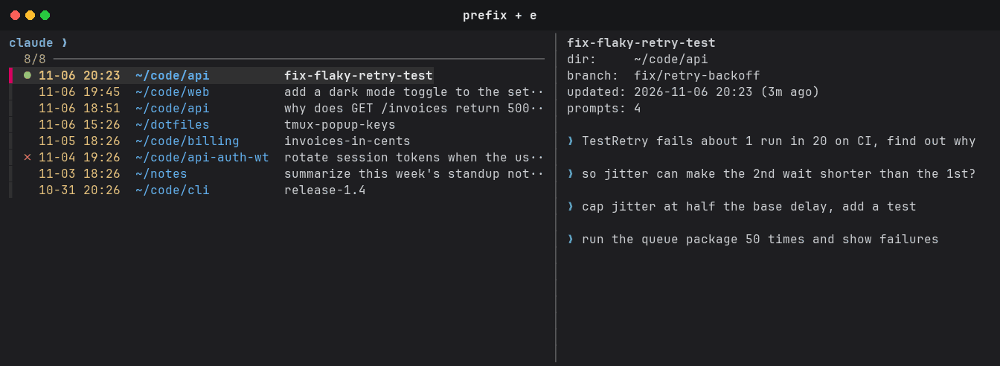

# tmux-claude-sessions

A tmux popup that lists your [Claude Code](https://claude.com/claude-code) sessions from every directory, newest first, and resumes the one you pick in a new window.



Press `prefix + e`, search, and press Enter. A green `●` marks a session that is already open; Enter switches to its pane.

## Install

Requires tmux 3.2+, [fzf](https://github.com/junegunn/fzf) and `python3`. With [tpm](https://github.com/tmux-plugins/tpm), add to `~/.tmux.conf` and press `prefix + I`:

```tmux
set -g @plugin 'perzhul/tmux-claude-sessions'
```

## Options

| Option | Default | |
| ------ | ------- | - |
| `@claude-sessions-key` | `e` | Key after the prefix |
| `@claude-sessions-width` | `80%` | Popup width |
| `@claude-sessions-height` | `80%` | Popup height |
| `@claude-sessions-command` | `claude` | Command the picker appends `--resume <id>` to |
